# glyphworks

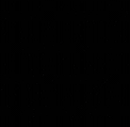

Real-time 3D works drawn entirely as glowing glyphs. WebGL2, Three.js, custom GLSL, React UI, no video. Models are plain triangle meshes. Runs in the browser, one page per work.

## Works

<table>
<tr><td align="center"><a href="https://kaandinc.com/glyphworks/heart/">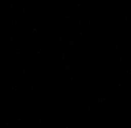<br>heart</a></td><td align="center"><a href="https://kaandinc.com/glyphworks/ring/"><br>ring</a></td><td align="center"><a href="https://kaandinc.com/glyphworks/wineglass/">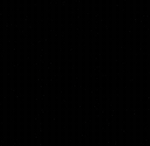<br>wineglass</a></td><td align="center"><a href="https://kaandinc.com/glyphworks/hourglass/"><br>hourglass</a></td></tr>
<tr><td align="center"><a href="https://kaandinc.com/glyphworks/mobius/">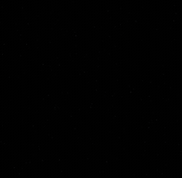<br>mobius</a></td><td align="center"><a href="https://kaandinc.com/glyphworks/knot/">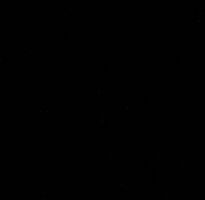<br>knot</a></td><td align="center"><a href="https://kaandinc.com/glyphworks/dna/">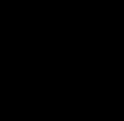<br>dna</a></td><td align="center"><a href="https://kaandinc.com/glyphworks/nautilus/">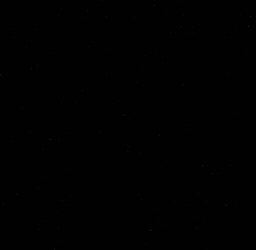<br>nautilus</a></td></tr>
<tr><td align="center"><a href="https://kaandinc.com/glyphworks/planet/">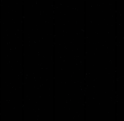<br>planet</a></td><td align="center"><a href="https://kaandinc.com/glyphworks/sauron-crown/">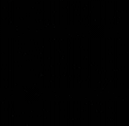<br>sauron-crown</a></td><td align="center"><a href="https://kaandinc.com/glyphworks/key/">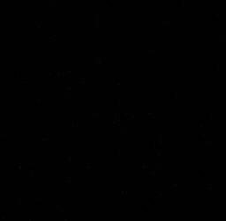<br>key</a></td><td align="center"><a href="https://kaandinc.com/glyphworks/can/">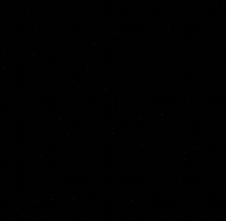<br>can</a></td></tr>
<tr><td align="center"><a href="https://kaandinc.com/glyphworks/beer-bottle/">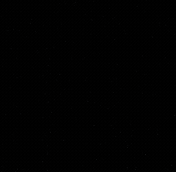<br>beer-bottle</a></td><td align="center"><a href="https://kaandinc.com/glyphworks/wine-bottle/">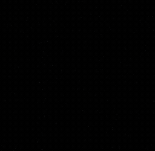<br>wine-bottle</a></td></tr>
</table>

| Work | What it is | |
| --- | --- | --- |
| `heart` | Hollow, inflated heart balloon, drawn from the tip upward | [Preview](https://kaandinc.com/glyphworks/heart/) |
| `ring` | Pavé diamond ring imported from a 3dm model: band, head prongs, then the main stone filling in | [Preview](https://kaandinc.com/glyphworks/ring/) |
| `wineglass` | Faceted wine glass with red wine, from a mesh: foot and stem first, then the bowl and the wine | [Preview](https://kaandinc.com/glyphworks/wineglass/) |
| `hourglass` | Hourglass from a mesh: plates, posts, see-through glass bulbs and sand | [Preview](https://kaandinc.com/glyphworks/hourglass/) |
| `mobius` | Möbius band: a wide ribbon with one half twist | [Preview](https://kaandinc.com/glyphworks/mobius/) |
| `knot` | Trefoil knot as one thick tube | [Preview](https://kaandinc.com/glyphworks/knot/) |
| `dna` | DNA double helix with base pairs | [Preview](https://kaandinc.com/glyphworks/dna/) |
| `nautilus` | Nautilus shell: logarithmic spiral with fine ribs | [Preview](https://kaandinc.com/glyphworks/nautilus/) |
| `planet` | Ringed planet with a moon | [Preview](https://kaandinc.com/glyphworks/planet/) |
| `sauron-crown` | Spiked crown from a mesh, rising from the base to the tips | [Preview](https://kaandinc.com/glyphworks/sauron-crown/) |
| `key` | Old key with a round bow and toothed bit | [Preview](https://kaandinc.com/glyphworks/key/) |
| `can` | Cola can imported from an OBJ: body rises from the base, rim and tab last | [Preview](https://kaandinc.com/glyphworks/can/) |
| `beer-bottle` | Beer bottle imported from an OBJ: see-through glass, beer, then the plug | [Preview](https://kaandinc.com/glyphworks/beer-bottle/) |
| `wine-bottle` | Wine bottle imported from an OBJ: see-through glass, wine, then the capsule | [Preview](https://kaandinc.com/glyphworks/wine-bottle/) |

All works in one place: [kaandinc.com/glyphworks](https://kaandinc.com/glyphworks/).

## Features (shared by all works)

- **Surface sampling:** random points scattered over the triangle mesh, proportional to area and a per-vertex weight; each point is one instanced glyph quad.
- **Lighting to glyph:** a fixed key light plus a rim light circling over time pick the character, so lit areas get dense glyphs and shadows get thin ones. Glyph centres snap to the pixel grid.
- **Correct occlusion:** a hidden depth pass of the real shell hides back glyphs; parts marked `ghost` (glass) are skipped, so liquid shows through.
- **Reveal timeline:** a per-vertex threshold draws each work in over 0.3-5.6 s, then a steady spin (12 s per turn).
- **Atmosphere:** thin cross-ray glints, drifting dust, faint orbit ellipses, light bloom.
- **Controls:** press `H` or click the dot (bottom right): replay, pause, speed, density, glyph scale, sparkles, particles, bloom, quality preset.

## Setup

```bash
npm install
npm run dev        # http://localhost:5173  (gallery), /heart/ for the heart
npm run build      # static site in dist/, works with any static host
```

Capture hook: `/heart/?t=9&angle=55&hold=1` jumps the timeline (seconds, degrees) and pauses.

## Layout

```
index.html              gallery, built from src/registry.json
src/registry.json       id, title, description of every work
<id>/index.html         entry page of a work (written by npm run sync), served at /<id>/
public/thumbs/<id>.jpg  gallery thumbnails
src/shared/             renderer, shaders, timeline, controls, mesh helpers (used by every work)
src/works/<id>/         geometry of one work: builds a surface mesh with per-vertex reveal order
```

## Adding a work

1. Create `src/works/<id>/scene.ts` exporting `scene` (a `SceneDef`: `build()` returns a mesh, `fit` frames the camera). Two ways to make the mesh:
   - from code: `src/shared/shapes.ts` has lathe, tube, sheet and box builders; see `src/works/knot/scene.ts` for a short example;
   - from a 3D file: export triangles to `src/works/<id>/mesh.json` and use `importedMesh` (`src/shared/importedMesh.ts`) with per-part rules for reveal order, density and see-through glass; see `src/works/can/scene.ts`.
2. Add `{ id, title, description }` to `src/registry.json`, run `npm run sync` to write `<id>/index.html`, and add a thumbnail at `public/thumbs/<id>.jpg`.

## Request a work

Want to see something new built as glyphs? [Open an issue](https://github.com/kaan0d/glyphworks/issues/new?template=new-work.md) with the object and, if you have one, a reference image or photo. Simple, recognisable shapes (a bottle, a ring, a lamp) work best. Pull requests with new works are welcome too, see "Adding a work".

## Limits

- Heart and parametric works were matched by eye, not fitted to pixels.
- Imported meshes (ring, bottles, can, wine glass, hourglass, crown) come from 3D files whose original licenses are not recorded here; check them before reusing the meshes outside this repo.
- Looked at in headless Chrome (software renderer) only; frame rates on real GPUs are unmeasured.
- WebGL2 required. Ultra quality needs a decent GPU, lower presets reduce counts and resolution.

## License

MIT, see [LICENSE](LICENSE).
